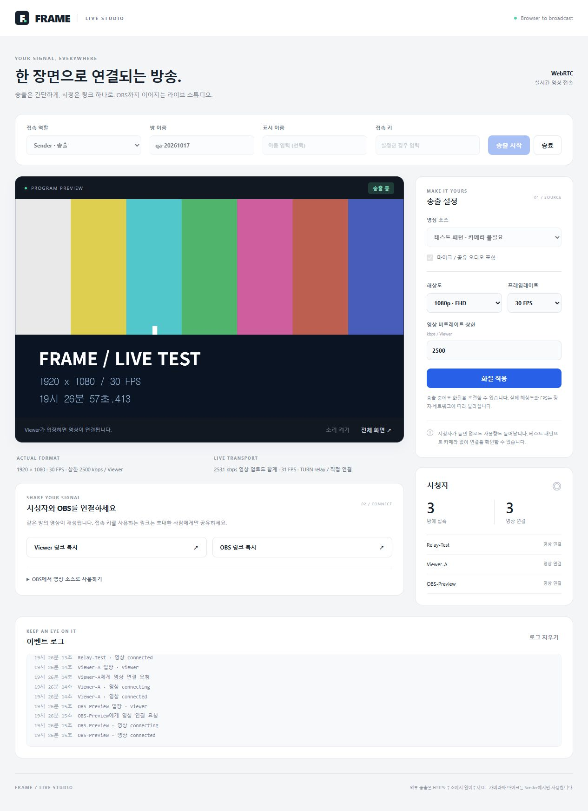
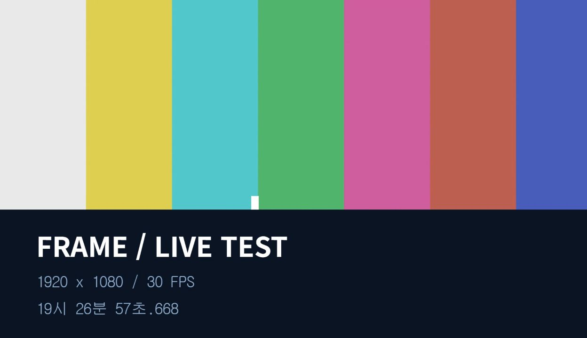

# FRAME — WebRTC Live Studio

Sender 1명이 카메라·화면을 송출하고 여러 Viewer가 링크로 시청하는 브라우저 스튜디오입니다.
Node.js는 방과 연결 신호를 관리하며, 영상은 브라우저 사이에서 전송됩니다. 직접 연결이 어려우면 coturn으로 중계합니다.



## 주요 기능

- 방마다 Sender 1명, 기본 Viewer 10명. Viewer는 카메라·마이크 권한을 요청하지 않습니다.
- 영상 소스: 카메라 / 화면 공유 / 움직이는 테스트 패턴(무음).
- 해상도 640×360 / 1280×720 / 1920×1080, FPS 15 / 24 / 30 / 60.
- 영상 비트레이트 상한 150~20000 kbps **각 Viewer 연결당** 설정. 송출 중 ‘화질 적용’으로 변경합니다.
- 실제 캡처 형식과 실측 영상 전송률·FPS, 직접 연결 / TURN relay 상태 표시.
- Sender의 방 접속 인원과 실제 영상 연결 인원, Viewer 이름·상태, 최근 120개 이벤트 로그.
- Viewer 링크 / OBS 전용 링크 복사. 서버 재접속 시 새 ID와 ICE 자격증명으로 재입장합니다.
- 접속 키를 설정하면 HTTP TURN 자격증명 API와 Socket.IO 입장을 모두 보호합니다.

이 구조는 Sender가 Viewer마다 별도로 업로드하는 일대다 P2P입니다. SFU는 구현하지 않았습니다.
예를 들어 2500 kbps로 Viewer 4명에게 보낼 때 영상 업로드 상한 합계는 약 10 Mbps이고,
오디오·프로토콜 오버헤드가 추가됩니다. 네트워크·장치에 따라 실제 해상도/FPS가 낮아질 수 있으며,
설정한 비트레이트는 목표 고정 전송률이 아닌 **영상 상한**입니다. 10명 모두의 1080p 품질을 보장하지 않습니다.

## 로컬 실행 — Docker

Docker Desktop과 Docker Compose 2.24.4 이상을 사용합니다. 공개 배포 파일이 `!override`를 사용합니다.

```powershell
Copy-Item .env.example .env
# 아래 명령으로 생성한 값을 .env의 TURN_SECRET에 입력합니다.
node -e "console.log(require('crypto').randomBytes(48).toString('hex'))"
docker compose up -d --build
```

이미 `.env`가 있으면 덮어쓰지 마세요. 기존 설정을 유지하고 새 변수만 추가합니다.
현재 작업 디렉터리의 `.env`에는 로컬 실행값이 준비되어 있습니다. 비밀값은 Git에 넣지 마세요.

- Sender: http://localhost:3000/?role=sender
- Viewer: http://localhost:3000/?role=viewer&room=studio
- OBS: http://localhost:3000/?obs=1&room=studio

1. Sender에서 방 이름·표시 이름과 영상 소스를 선택하고 ‘송출 시작’을 누릅니다.
2. 카메라 없이 확인하려면 ‘테스트 패턴’을 선택합니다. Viewer보다 먼저/나중에 입장해도 됩니다.
3. ‘Viewer 링크 복사’로 같은 방 링크를 전달합니다. 실제 외부 사용자에게는 HTTPS 배포 주소가 필요합니다.
4. 해상도/FPS/비트레이트를 바꾼 후 ‘화질 적용’을 누릅니다. Viewer의 실제 수신 형식도 확인하세요.
5. ‘종료’를 누르면 방에서 나가고 캡처 트랙과 연결을 정리합니다.

로컬 Compose는 HTTP 3000, TURN 3478 TCP/UDP와 UDP 40000~40249를 **127.0.0.1에만** 공개합니다.
로컬 loopback 중계를 위해 `--allow-loopback-peers`를 사용합니다. 공개 배포에서는 이 옵션을 제거한 별도 명령을 씁니다.
Windows Docker의 대량 포트 게시 부담을 피하려고 relay UDP 포트를 250개로 제한했습니다.
Windows 기본 동적 UDP 범위(49152 이상)와의 충돌을 피하는 기본값이며,
`TURN_MIN_PORT` / `TURN_MAX_PORT`로 변경할 수 있습니다. 변경 시 방화벽 허용 범위도 함께 바꾸세요.

### Docker 없이 Node 서버 실행

Node.js 20 이상:

```powershell
npm ci
# Docker signaling이 이미 실행 중이면 포트 충돌 방지:
docker compose stop signaling
# TURN만 실행할 경우:
docker compose up -d turnserver
npm start
```

`.env`에서 TURN을 비워 STUN만 사용할 수도 있지만, 다른 네트워크 간 연결은 실패할 수 있습니다.
개발용 `npm run dev`는 Node 파일 변경 시 서버를 재시작합니다. 정적 HTML/JS/CSS 변경은 브라우저를 새로고침하세요.

## 외부 접속 — kbctest.kro.kr

2026-10-18 확인: `kbctest.kro.kr`의 DNS 등록은 완료했습니다. 현재 PC 내부의 HTTP 응답과
TURN 인증 Allocate는 확인했지만, 외부 인증기관에서 TCP 80/443에 접근하면 시간 초과가 발생했습니다.
**HTTPS 인증서는 발급되지 않았고 외부 접속도 완료되지 않았습니다.**
사용자에게 공유기·네트워크 관리 권한이 없어 이 PC의 직접 공개 방식은 중단했습니다.
인증서 발급 재시도도 중지하고 로컬 구성을 복구했습니다.

고정 도메인을 유지하려면 외부에서 접근 가능한 서버에 Caddy·signaling·coturn을 배포하고,
`kbctest.kro.kr`의 A 레코드를 그 서버의 공인 IPv4로 변경합니다. Sender는 현재 PC의 브라우저로
HTTPS 주소에 접속하므로 현재 네트워크의 인바운드 포트포워딩은 필요하지 않습니다.
외부 서버의 방화벽과 보안그룹은 아래 포트를 허용해야 합니다.
실제 서버 접속 정보가 준비되기 전에는 구매·배포·DNS 변경을 진행하지 않습니다.

임시 접속 시험 대안과 정식 배포 절차는 [외부 배포 안내](docs/DEPLOYMENT.md)를 참고하세요.

현재 무료 시험용 HTTPS 터널을 별도 구성으로 실행했습니다. 접속 키를 포함한 링크는
로컬의 `TUNNEL-ACCESS.private.html`에서 엽니다. 재실행은 `node tools/tunnel-trial.js start`,
주소 확인은 `node tools/tunnel-trial.js status`, 종료는 `node tools/tunnel-trial.js stop`입니다.
이 방식은 임시 `trycloudflare.com` 주소를 사용하며 `kbctest.kro.kr`의 정식 배포가 아닙니다.
외부 TURN 없이 STUN 직접 연결만 시험하므로 다른 네트워크에서 영상이 실패할 수 있습니다.

로컬 `.env`를 보존하고 별도 `.env.public`에서 다음 항목을 실제 서버 값으로 설정합니다.
현재 PC에 준비한 `.env.public`은 비공개이며 현재 네트워크 진단용 값과 staging 인증기관을 사용합니다.
외부 서버에 옮길 때 공인 IP를 바꾸고 연결 확인 후 production 인증기관으로 전환해야 합니다.

```dotenv
PUBLIC_DOMAIN=kbctest.kro.kr
ACME_EMAIL=
ACME_CA=https://acme-staging-v02.api.letsencrypt.org/directory
TURN_HOST=kbctest.kro.kr
TURN_EXTERNAL_IP=실제_공인_IPv4
ACCESS_KEY=길고_무작위인_접속_키
TURN_SECRET=길고_무작위인_TURN_공유_비밀
TURN_MIN_PORT=40000
TURN_MAX_PORT=40249
```

- `PUBLIC_DOMAIN`은 `https://`나 경로를 제외한 호스트 이름입니다.
- 두 DNS 이름의 A 레코드를 공인 IPv4로 연결합니다. 같은 호스트 이름을 두 용도로 써도 됩니다.
  TURN용 DNS는 UDP를 전달하지 않는 웹 프록시를 통하지 않아야 합니다.
- 서버 방화벽·클라우드 보안그룹에서 TCP 80/443, TCP/UDP 3478, UDP 40000~40249를 허용합니다.
  공유기 뒤의 서버를 사용한다면 같은 포트를 서버로 전달할 네트워크 관리 권한도 필요합니다.
- `ACME_EMAIL`은 선택 항목입니다. 인증서 관련 연락을 받을 이메일이 있으면 입력하세요.
- staging 인증서는 브라우저에서 신뢰하지 않습니다. 외부 연결 시험 후 `ACME_CA`를 비우면
  기본 production 인증기관을 사용합니다. 변경 후 Caddy를 다시 생성하고 발급 성공을 확인하세요.
- `TURN_EXTERNAL_IP=127.0.0.1`, `TURN_HOST=localhost`는 반드시 외부 주소로 바꿉니다.
- 공유기가 통신사 NAT/CGNAT 뒤에 있으면 포트포워딩만으로 해결되지 않습니다. 도달 가능한 공인 IP 또는 VPS가 필요합니다.
- 공개용 `ACCESS_KEY`는 필수입니다. 접속 키를 아는 사람은 방에 입장할 수 있으므로 신뢰하는 사용자에게만 전달합니다.

```powershell
docker compose --env-file .env.public -f docker-compose.yml -f docker-compose.public.yml config --quiet
docker compose --env-file .env.public -f docker-compose.yml -f docker-compose.public.yml up -d --build
```

도메인과 외부 80/443 연결이 정상일 때 Caddy가 인증서를 발급·갱신하고 HTTPS/WebSocket을 Node 서버로 전달합니다.
외부 사용자는 `https://실제도메인/?role=sender` 또는 복사된 Viewer 링크로 접속합니다.
공개용 파일은 TURN 포트를 외부 인터페이스에 게시하고 loopback 허용 옵션을 제외합니다.

**HTTPS와 TURN은 별도 경로입니다.** Caddy의 443 포트는 웹 접속용이며 TURN/TLS가 아닙니다.
현재 배포는 TURN UDP/TCP 3478을 제공합니다. UDP/TCP 3478이 모두 차단된 네트워크를 위한
TURN/TLS 443/5349는 별도의 인증서·포트·coturn 설정이 필요하며 현재 자동 구성에는 포함되지 않습니다.
서버의 선택 설정 `TURN_TLS_PORT`는 실제 TURN/TLS를 준비한 경우에만 사용하세요.

공개 배포 후에는 휴대전화 데이터 등 **다른 네트워크**의 Viewer로 영상과 오디오를 확인하세요.
현재 수행한 localhost TURN 시험은 외부 DNS·방화벽·NAT 경로의 통과를 증명하지 않습니다.

## OBS에서 사용하기

### 영상만 받기 — 브라우저 소스

1. Sender에서 ‘OBS 링크 복사’를 누릅니다.
2. OBS ‘소스’ → ‘+’ → **브라우저**를 추가합니다. ‘로컬 파일’을 끄고 복사한 URL을 붙여넣습니다.
3. 너비 1920, 높이 1080, 필요하면 사용자 지정 FPS를 송출 FPS에 맞춥니다.
4. ‘OBS를 통해 오디오 제어 / Control audio via OBS’를 켜고 믹서에 오디오가 들어오는지 확인합니다.
5. 자동재생 소리가 차단되면 소스 ‘상호작용’에서 ‘영상 재생 / 소리 켜기’를 누릅니다.
6. 방송 중 연결을 유지하려면 ‘보이지 않을 때 소스 종료’를 끄고 장면 활성화 시 새로고침도 필요에 따라 끕니다.

OBS URL의 `obs=1`은 무조건 Viewer로 접속하며, 카메라를 요청하지 않고 영상만 검은 배경에 꽉 채웁니다.
해상도 비율이 다르면 영상은 자르지 않고 여백을 유지합니다. Sender가 나가면 대기하고 복귀하면 다시 연결합니다.



### 설정·로그까지 화면 전체를 그대로 보여주기

일반 브라우저에서 Sender 대시보드를 연 다음 OBS의 **윈도우 캡처** 소스로 해당 브라우저 창을 선택합니다.
영상만 필요하면 위 브라우저 소스 방식이 적합합니다. OBS 자체 창을 캡처 대상으로 선택하지 마세요.
실제 OBS 프로그램에서의 수신·녹화 검증은 아직 수행하지 않았습니다.

## URL과 접속 키

- `?role=sender&room=studio`: Sender 설정 화면.
- `?role=viewer&room=studio&autojoin=1`: 카메라 없이 Viewer 자동 입장.
- `?obs=1&room=studio`: OBS용 Viewer 자동 입장. `role=sender`가 같이 있어도 Viewer가 됩니다.
- `&name=표시이름`: 표시 이름.
- `&relay=1`: 직접 연결 없이 TURN만 사용하여 중계 경로를 진단합니다.
- `#key=...`: 접속 키. 복사 버튼이 필요할 때 추가합니다. 서버 요청 URL/쿼리나 localStorage에 저장하지 않습니다.
  다만 링크를 받은 사람과 브라우저/OBS 설정에는 키가 남으므로 링크 자체를 비밀로 취급하세요.

## 검사 및 문제 해결

```powershell
npm test
python -B tools/turn_check.py
# 별도 서버 또는 로컬 진단 목적의 UDP 대상 주소 지정:
python -B tools/turn_check.py --url http://localhost:3000 --host 127.0.0.1
```

API를 접속 키로 보호했다면 검사 프로세스의 `ACCESS_KEY` 환경변수에 같은 값을 설정합니다.
검사 도구는 `.env`를 자동으로 읽지 않습니다. 키나 TURN 자격증명을 로그에 출력하지 않습니다.
처음 받는 401은 정상 인증 challenge입니다. 이어지는 **authenticated Allocate SUCCESS**가 성공 조건입니다.
이 검사는 인증·할당만 확인합니다. 실제 영상 중계는 `relay=1` Viewer의 화면과 ‘TURN relay’ 표시로 확인하세요.

- `/api/health`의 `ok=true`는 HTTP 서버 상태이며 영상 연결/TURN 성공을 뜻하지 않습니다.
- Sender 중복 입장은 거부합니다. 기존 Sender 종료 또는 다른 방 이름을 사용하세요.
- 카메라가 없거나 권한을 거부하면 시작을 취소하고 트랙을 정리합니다. 테스트 패턴으로 통신만 확인할 수 있습니다.
- 외부 HTTP 주소는 카메라·화면 캡처를 지원하지 않습니다. HTTPS 또는 localhost가 필요합니다.
- 원격 Viewer의 `localhost`는 Viewer 자신의 컴퓨터입니다. 외부 환경에서는 TURN_HOST를 서버 도메인으로 바꾸세요.
- 화면 공유의 오디오는 브라우저와 공유 대상에 따라 제공되지 않을 수 있습니다.
- 비트레이트/FPS 상한 적용을 지원하지 않는 브라우저는 오류를 로그에 표시하며 연결은 유지합니다.

## 현재 검증 범위 (2026-10-18)

- Node 자동 검사 15개 통과: 역할 제한, 정원, 잘못된 요청, 신호 형식/발신자 보호, 입퇴장,
  방 변경, 인증, TURN HMAC, Viewer 무캡처, 권한 대기 중 취소, 재접속, 짧은 TURN TTL 갱신.
- 실제 브라우저: 테스트 패턴 → 일반 Viewer / OBS 모드 / 강제 TURN Viewer 동시 수신.
- 1920×1080 30 FPS 수신, 송출 중 640×360 15 FPS 500 kbps 상한 변경 확인.
- 실제 coturn UDP 인증 Allocate 성공. Sender 퇴장/복귀 후 Viewer 자동 재연결 확인.
- 공개 Compose 구문과 이메일을 생략한 Caddy 설정 검증 통과. 실제 도메인 DNS 응답 확인.
- 공개 구성의 로컬 HTTP 응답과 TURN 인증 Allocate 확인. 외부 ACME의 80/443 연결은 시간 초과하여 인증서 발급 실패.
- 관리 권한이 없어 직접 공개를 중단하고 로컬 구성으로 복귀했습니다. 외부 영상 연결은 검증되지 않았습니다.
- 별도 무료 터널의 HTTPS/API·접속 키·Origin 제한·WebSocket 확인. 같은 PC 브라우저에서 HTTPS로 입장해 일반/OBS Viewer 동시 수신 및 720p30 → 360p15 / 500 kbps 변경 확인.
- 실물 카메라·마이크, 화면 공유 장치 선택, 실제 OBS 녹화, 외부망 접속 및 10명 부하 시험은 별도 확인이 필요합니다.

## 파일

`server.js` / `public/index.html` / `public/main.js` / `public/style.css` / `test/` /
`docker-compose.yml` / `docker-compose.public.yml` / `Caddyfile` / `tools/turn_check.py`.
이전 Mesh 클라이언트의 메시지 형식과는 호환되지 않으므로 수정 후 모든 브라우저 탭을 새로고침하세요.

공식 문서: [OBS Browser Source](https://obsproject.com/kb/browser-source),
[coturn 설정](https://github.com/coturn/coturn/blob/master/examples/etc/turnserver.conf),
[Caddy Reverse Proxy](https://caddyserver.com/docs/caddyfile/directives/reverse_proxy),
[WebRTC 표준](https://www.w3.org/TR/webrtc/).
