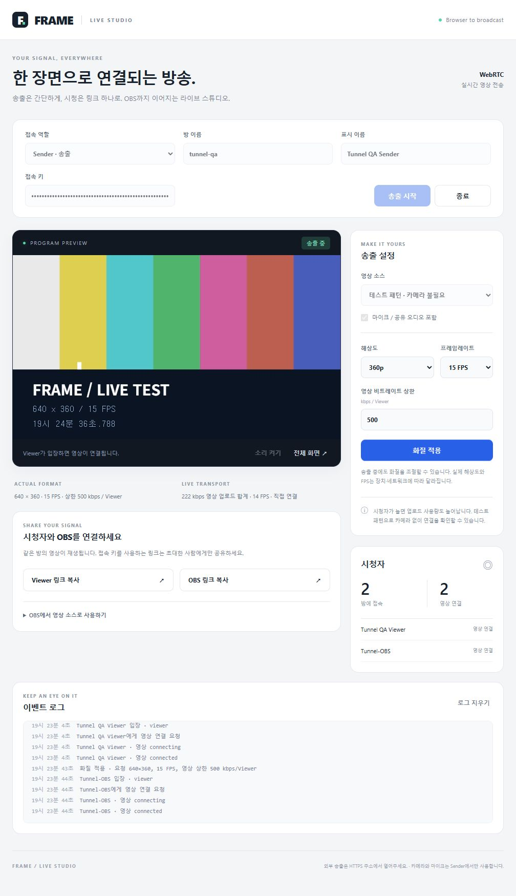

# 외부 접속 배포 안내

## 확인된 상황 — 2026-10-18

- 사용할 도메인: `kbctest.kro.kr`. DNS 등록 완료.
- 현재 PC 내부의 HTTP 응답과 coturn 인증 Allocate는 성공했습니다.
- 외부 ACME 인증기관에서 현재 공인 주소의 TCP 80/443에 접근하면 시간 초과가 발생했습니다.
- 공유기·네트워크 관리 권한이 없으므로 현재 PC로 인바운드 포트를 전달할 수 없습니다.
- HTTPS 인증서는 아직 없고 외부 Viewer 영상 수신도 검증하지 못했습니다.
- 실패한 staging 발급 재시도는 중단했습니다. 기본 로컬 실행은 `http://localhost:3000`입니다.

DNS 등록만으로 방화벽이나 NAT 경로가 열리지는 않습니다. DNS 인증으로 인증서를 받더라도
웹 접속 및 TURN 포트의 접근 문제가 해결되지는 않습니다.

## 고정 도메인으로 운영하기

외부에서 접근 가능한 서버에 이 저장소의 전체 스택을 배포합니다.

```text
Sender 브라우저 ── HTTPS/WSS ── 외부 서버의 Caddy → signaling
Viewer / OBS    ── HTTPS/WSS ──┘
Sender 브라우저 ←──── 직접 WebRTC 또는 외부 coturn 중계 ────→ Viewer / OBS
```

현재 PC에는 Sender 브라우저만 필요합니다. 서버를 외부에 두면 현재 공유기의 인바운드 설정을
바꾸지 않아도 됩니다. 다만 Sender/Viewer 네트워크가 서버로 나가는 통신까지 차단한다면
연결이 제한될 수 있습니다. 현 구성은 TURN UDP/TCP 3478이며 TURN/TLS 443은 포함하지 않습니다.

필요한 준비물은 Docker Compose 2.24.4 이상을 실행할 서버의 접속 정보, 공인 IPv4,
서버 방화벽을 설정할 권한, 도메인 A 레코드 변경 권한입니다. 서버 구매는 별도로 결정합니다.
영상이 중계되면 서버 트래픽이 증가합니다. 이 구현은 Sender가 Viewer별로 업로드하므로
Sender의 업로드 대역폭도 Viewer 수에 따라 증가합니다.

1. 서버에 저장소를 내려받습니다. 비공개 저장소이므로 소유 계정으로 인증합니다.
2. `.env.example`을 `.env.public`으로 복사합니다. 기존 파일이 있다면 덮어쓰지 않습니다.
3. `PUBLIC_DOMAIN`과 `TURN_HOST`를 `kbctest.kro.kr`, `TURN_EXTERNAL_IP`를 **새 서버 공인 IPv4**로 설정합니다.
4. `ACCESS_KEY`와 `TURN_SECRET`에 각각 다른 긴 무작위 값을 설정합니다. `.env.public`은 Git에 넣지 않습니다.
5. 도메인의 A 레코드를 새 서버 공인 IPv4로 변경합니다. TURN DNS는 HTTP 프록시를 거치지 않습니다.
6. 외부 서버에서 TCP 80·443·3478, UDP 3478·40000–40249를 허용합니다.
7. 첫 시험에는 `ACME_CA=https://acme-staging-v02.api.letsencrypt.org/directory`로 설정합니다.
   `ACME_EMAIL`은 선택 항목입니다. 실제 연락 이메일이 있을 때만 입력합니다.

서버의 프로젝트 디렉터리에서 실행합니다.

```sh
docker compose --env-file .env.public -f docker-compose.yml -f docker-compose.public.yml config --quiet
docker compose --env-file .env.public -f docker-compose.yml -f docker-compose.public.yml up -d --build
docker compose --env-file .env.public -f docker-compose.yml -f docker-compose.public.yml logs --tail 50 caddy
```

외부 연결과 staging 발급이 성공하면 `ACME_CA`를 비워 production으로 전환합니다.
staging 인증서는 신뢰되는 인증서가 아니므로 시험 중 브라우저 경고를 우회하지 않습니다.

```sh
docker compose --env-file .env.public -f docker-compose.yml -f docker-compose.public.yml up -d --force-recreate caddy
```

발급 완료 후 외부 네트워크에서 다음을 확인합니다.

- 브라우저가 정상 인증서로 `https://kbctest.kro.kr/api/health`에 접속하는지 확인합니다.
- Sender 페이지에 입장하고 비공개 접속 키를 입력한 뒤 테스트 패턴을 송출합니다.
- 휴대전화 데이터 등 다른 네트워크에서 복사한 Viewer 링크로 영상을 받습니다.
- Viewer 링크에 `relay=1`을 추가하고 Sender에서 `TURN relay` 표시와 실제 영상을 확인합니다.
- 해상도/FPS/비트레이트 변경과 Sender 복귀 후 재연결을 확인합니다.
- OBS 브라우저 소스에 OBS 링크를 넣고 영상·소리·녹화를 확인합니다.

서버 상태 API나 TURN Allocate 성공만으로 실제 외부 영상 중계 성공을 판단하지 않습니다.
인증 정보를 담은 링크는 공개 문서·이슈·로그에 붙이지 않습니다.

## 임시 HTTPS 터널로 시험하기

Cloudflare Quick Tunnel은 로컬 웹 서비스에 임시 `trycloudflare.com` 주소를 제공합니다.
계정이나 도메인 없이 시험할 수 있지만 재실행할 때 호스트 이름이 바뀌고 가동률 보장이 없습니다.
따라서 이 방식으로 `kbctest.kro.kr` 배포가 완료되었다고 판단하지 않습니다.

이 앱에 적용할 때에는 먼저 별도 시험 환경에 접속 키를 설정하고 실제 터널 HTTPS 주소를
`CORS_ORIGIN`으로 허용해야 합니다. `.env`의 `TURN_HOST=localhost`를 외부 Viewer에게 제공하면
Viewer 자신의 PC를 가리키므로 사용할 수 없습니다. 외부 TURN이 없다면 STUN 직접 연결만
시험할 수 있으며 NAT/방화벽 조합에 따라 영상이 실패합니다.

일반 HTTP 터널은 이 구성의 UDP TURN 포트나 relay 범위를 그대로 공개하는 수단이 아닙니다.
웹과 Socket.IO가 연결되어도 영상 수신 성공을 별도로 확인해야 합니다.
사용자 요청에 따라 임시 터널 시험 구성을 추가하고 실행했습니다. 기본 로컬 서비스와 별도로
`webrtc-tunnel` Compose 프로젝트를 사용하며, 시험 서버의 로컬 포트는 `127.0.0.1:3001`입니다.
TURN 설정은 비워 두고 STUN 직접 연결을 시험합니다.

프로젝트 폴더에서 Docker Desktop을 실행한 상태로 다음을 사용합니다. Node.js와 `npm ci`도 필요합니다.

```powershell
node tools/tunnel-trial.js start
node tools/tunnel-trial.js status
# 시험 종료 시:
node tools/tunnel-trial.js stop
```

`start`는 별도 `.env.tunnel`에 무작위 접속 키를 생성하고 cloudflared를 실행한 뒤,
실제 임시 HTTPS 주소를 `CORS_ORIGIN`에 반영합니다. 기존 `.env`와 `.env.public`은 바꾸지 않습니다.
같은 터널이 실행 중이면 재사용합니다. 터널을 종료하고 다시 만들면 새 주소를 받습니다.
Docker/PC 재시작 후 자동으로 공개하지 않으며 필요할 때 `start`로 다시 시작합니다.

HTTPS 인증 API 응답을 확인한 후 프로젝트 폴더의 `TUNNEL-ACCESS.private.html`에
Sender·Viewer·OBS 접속 키가 포함된 링크를 저장합니다. 이 파일을 브라우저로 열고 Sender를 선택합니다.
Sender에서 ‘테스트 패턴’을 선택하여 송출한 뒤 Viewer 링크를 신뢰하는 시험자에게 전달합니다.
OBS에는 ‘OBS 영상 전용’의 링크 주소를 복사해 브라우저 소스로 넣습니다.
`.env.tunnel`과 접속 링크 파일은 Git 및 Docker 빌드에서 제외됩니다.

`stop`은 이 시험 프로젝트의 컨테이너와 네트워크만 내리고 접속 링크 파일을 종료 안내로 바꿉니다.
기본 로컬 서비스 및 비밀 설정은 보존합니다. 접속 키도 유지하므로 키를 아는 사람의 접근은
다음 시험에서 다시 가능할 수 있습니다. 키를 바꾸려면 터널을 종료한 상태에서 `.env.tunnel`의
`ACCESS_KEY`를 새 32바이트 무작위 16진수 값으로 바꾸고 새 링크만 공유하세요.

2026-10-18 시험에서 임시 HTTPS 페이지/API, 접속 키 없는 요청 거부, 허용하지 않은 Origin 거부,
인증된 WebSocket 연결 및 같은 PC의 브라우저 Sender → Viewer 영상 수신을 확인했습니다.
OBS 자동 입장 Viewer와 일반 Viewer 동시 수신, 720p 30 FPS에서 송출 중 360p 15 FPS /
500 kbps 상한 변경도 확인했습니다. 실제 OBS 프로그램 수신 검증은 별도입니다.
별도 외부 네트워크의 실제 영상 수신은 아직 검증하지 못했습니다.



공식 근거:
[Quick Tunnels](https://developers.cloudflare.com/tunnel/get-started/quick-tunnels/),
[Tunnel routing](https://developers.cloudflare.com/tunnel/concepts/routing/),
[Caddy HTTPS](https://caddyserver.com/docs/automatic-https),
[Caddy global options](https://caddyserver.com/docs/caddyfile/options).

## 현재 PC에서 로컬 실행으로 복귀

`.env.public`과 Caddy 데이터 볼륨을 지우지 않고 공개 HTTPS 서비스를 정지합니다.
로컬 `.env`는 처음부터 별도로 보존합니다.

```powershell
docker compose --env-file .env.public -f docker-compose.yml -f docker-compose.public.yml stop caddy
docker compose --env-file .env up -d
```

중지된 Caddy 컨테이너가 orphan으로 표시될 수 있으며 기본 로컬 서버 동작에는 영향을 주지 않습니다.
로컬 Compose는 HTTP와 TURN 포트를 `127.0.0.1`에만 게시합니다.
